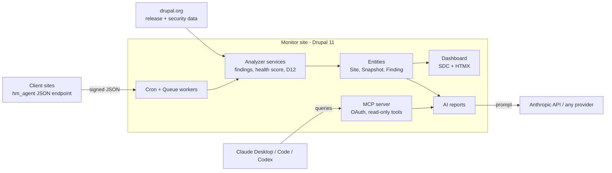

# Drupal Health Monitor

[](https://github.com/FLoRyN1994/DrupalHealthMonitor/actions/workflows/ci.yml)
[](LICENSE.txt)

> A fleet dashboard for Drupal maintenance retainers: core/module versions, security
> updates, Drupal 12 readiness and uptime for every client site, with AI-written client
> reports and an MCP server so you can ask Claude about your fleet.

<!-- TODO: dashboard screenshot or GIF -->

## Why

Freelancers and agencies running Drupal maintenance retainers juggle updates and security
advisories across many sites by hand. Health Monitor collects a signed snapshot from each
client site, flags security updates, unsupported versions and Drupal 12 blockers with
deterministic PHP, and turns the findings into a plain-English report. See
[`docs/BLUEPRINT.md`](docs/BLUEPRINT.md) for the full scope, architecture diagram and
why this differs from Warden, Status Dashboard and Upgrade Status.

## Architecture



Two codebases, one repo: the **monitor** (`hm_core`, the dashboard) and a small
**agent** (`hm_agent`) installed on each client site.

## Setup

```bash
ddev start
ddev composer install
ddev drush recipe ../recipes/health_monitor
```

<!-- TODO: recipe not built yet (M6) — until then: ddev drush site:install --existing-config -->

## MCP demo

<!-- TODO: once the MCP module (M6) is wired up -->

Ask Claude Desktop or Claude Code: *"Which client sites need security updates this week,
and how many hours in total?"* and it answers from live data on this Drupal site via:

- `list_sites`
- `get_site_findings`
- `get_security_updates`
- `generate_site_report`

## Status

Early build-in-progress. See [`docs/PROGRESS.md`](docs/PROGRESS.md) for the current
milestone and [`docs/DECISIONS.md`](docs/DECISIONS.md) for decisions already made.

## What I'd do next

<!-- TODO: fill in once MVP milestones (M1-M6) are done -->

## License

[GPL-2.0-or-later](LICENSE.txt), same as Drupal.
