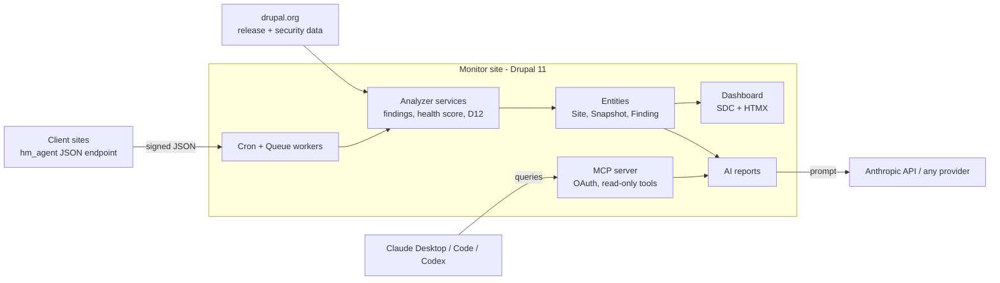

# Drupal Health Monitor — Project Scope

Last synced from the Claude doc: Oct 28, 2026. This file is the source of truth for coding agents.

## Overview

Drupal Health Monitor is a Drupal 11 dashboard that tracks many client Drupal sites in one place: core and module versions, security updates, Drupal 12 readiness and uptime. An AI layer turns raw findings into a plain-English report per site, and an MCP server lets you ask Claude about your fleet.

- **Who it's for:** freelancers and agencies running maintenance retainers. Primary user is you, for tofdev.com.
- **Why it works as a portfolio piece:** it shows modern Drupal architecture (custom entities, queues, OOP hooks, SDC, HTMX), real AI integration and MCP, plus a public repo with CI.
- **Two codebases in one repo:** the **monitor** (the dashboard site) and a small **agent** module installed on each client site.

## Why not Warden or Upgrade Status

Upgrade Status scans one site's code before a major upgrade; existing fleet tools only list available updates. Health Monitor builds on both and adds what a retainer business needs.

| Tool | What it does | Gap Health Monitor fills |
| --- | --- | --- |
| [Upgrade Status](https://www.drupal.org/project/upgrade_status) | One-off deprecation scan on a single site | No fleet view, history or alerts. Used as a data source: the agent reports its results |
| [Warden](https://www.drupal.org/project/warden) | Fleet update dashboard (Symfony server) | Maintenance fixes only, no AI, no D12 view |
| [Status Dashboard](https://drupal.org/project/status_dashboard) | Hub + client module, update list, email alerts | Dev release only, raw version lists |
| [Multisite Status Report](https://www.drupal.org/project/multisite_status_report) | HMAC-signed status endpoints + dashboard | No analysis, reports or client output |

**Differentiators (what to build and talk about):**

1. **AI client reports:** email-ready summary with effort estimate per site.
2. **MCP fleet queries:** ask Claude across all sites ("which need security work this week, total hours?").
3. **D12 readiness per site:** agent forwards Upgrade Status scan results when that module is present.
4. **Release-notes digest:** what each update fixes, in one line.
5. **Composer audit:** PHP library CVEs, not just Drupal modules.
6. **Built for retainers:** hours estimates, monthly client PDF report, client-facing read-only view.

Points 1 to 4 are MVP; 5 and 6 are stretch goals.

## MVP features

The MVP covers registering sites, collecting data, flagging problems and showing them on one dashboard.

1. **Clients and sites:** add a client, add its sites (URL, environment, agent key).
2. **Agent module on client sites:** exposes a signed JSON endpoint with core version, PHP version, enabled modules and their versions, and pending DB updates.
3. **Scheduled checks:** cron plus Queue API fetch each site's snapshot and an HTTP uptime ping.
4. **Update analysis:** compare each module against drupal.org release data. Flag security updates, regular updates and unsupported versions.
5. **Drupal 12 readiness:** flag modules with no D12-compatible release, deprecated core modules in use (Contact, History, Field Layout and others), and Upgrade Status scan results when that module is installed on the client.
6. **Dashboard:** fleet overview with a health score per site, filters, and HTMX refresh without page reloads.
7. **Site detail page:** findings table, snapshot history, uptime log.
8. **AI report:** one-click plain-English summary per site, with effort estimate, ready to send to the client.
9. **Alerts:** email when a new security update affects a site.

**Out of scope for MVP:** applying updates automatically, a client-facing login, billing, non-Drupal sites.

## Architecture

Client sites push snapshots to the monitor; plain PHP analyzer services create findings; AI only writes summaries, and MCP exposes the same data to Claude.



**Agent auth:** each site gets a shared secret (Key module on both sides). The monitor signs requests with HMAC plus a timestamp; the agent rejects unsigned or stale calls and never exposes data publicly.

## Content model

Use custom content entities, not nodes: this data is operational, not editorial, and custom entities show stronger Drupal skills. Generate them with `drush generate entity:content`, then refactor to attributes and typed properties.

| Entity | Key fields | Notes |
| --- | --- | --- |
| Client | name, contact email, retainer tier, notes | Owns many Sites |
| Site | label, base URL, environment (prod/stage), agent key (Key module ref), client ref, status, health score | Health score computed on each snapshot |
| Snapshot | site ref, timestamp, core version, PHP version, modules (JSON), pending updates, raw payload | Append-only history, prune after 90 days |
| Finding | site ref, project name, type (security / update / unsupported / D12 blocker), severity, current version, recommended version, resolved flag | Deduplicated per site + project + type |
| Uptime check | site ref, timestamp, HTTP status, response time ms | Lightweight, could be a plain DB table |
| AI report | site ref, generated date, summary text, effort estimate, model used | Keeps every version for comparison |

Taxonomy: **Tags** on Site (stack, hosting such as Acquia or Pantheon) for filtering.

## Tech stack

Start from plain Drupal 11.4 core (recommended project), not Drupal CMS: a dashboard app needs few CMS features, and a lean base shows your architecture clearly.

| Layer | Choice | What you learn |
| --- | --- | --- |
| Platform | Drupal 11.4, PHP 8.4, MySQL 8.4 | Latest minor, D12-ready code |
| Local dev | DDEV, Drush 13 | Standard agency setup |
| Custom code | Modules `hm_core` (monitor) and `hm_agent` (client sites) | OOP hooks, attributes, autowiring, Queue API, Plugin API |
| HTTP | Guzzle via `http_client` service | Async requests, timeouts, retries |
| Front-end | Custom theme from starterkit, SDC components, HTMX | Component-driven theming, less JS |
| Admin | Navigation module, Default Admin theme | Current admin UX |
| Secrets | Key module | Safe storage of agent keys and AI API keys |
| Listings | Views + custom Views field plugins | Health score and badge rendering |
| Install | A site recipe (`recipes/health_monitor`) | One-command setup, recipes API |
| AI | AI module, Anthropic provider, AI Agents | Provider abstraction, function calling |
| MCP | MCP module 1.2 + Simple OAuth | Exposing Drupal as AI tools |
| Quality | PHPStan (level 6+), PHPCS Drupal standard, drupal-rector, PHPUnit (unit + kernel) | Professional code quality |

## AI and MCP features

AI only summarizes and explains findings; all detection logic stays deterministic PHP. This keeps results reliable and tests simple.

**AI features (via the AI module, so the provider is swappable):**

1. **Client report:** from a site's open findings, generate a short email-ready summary: what's wrong, why it matters, effort estimate in hours. Stored as an AI report entity.
2. **Release notes digest:** for each pending update, summarize the drupal.org release notes into one line ("fixes XSS in admin form").
3. **D12 upgrade advice:** for each D12 blocker, suggest the path (wait, patch, replace with module X), clearly marked as a suggestion.
4. **Fleet chatbot (optional):** an AI Agents tool that answers "which sites have security updates?" inside the admin.

**MCP server (MCP module 1.2, OAuth):** expose a few read-only tools so Claude Desktop or Claude Code can query your fleet:

- `list_sites` with health score and open finding counts
- `get_site_findings` for one site
- `get_security_updates` across all sites
- `generate_site_report` (triggers the AI report)

Demo for the README: in Claude, ask "Which client sites need security updates this week, and how many hours in total?" and show it answering from your Drupal site.

## Repo and GitHub setup

One public repo; a reviewer should get a working site with demo data in one command.

```
drupal-health-monitor/
├── .ddev/                     # DDEV config, plus 2 extra "client" sites for demo
├── .github/workflows/ci.yml   # PHPCS, PHPStan, PHPUnit on every push
├── config/sync/               # exported config
├── recipes/health_monitor/    # one-command install + demo content
├── web/modules/custom/
│   ├── hm_core/               # entities, queue workers, services, MCP tools
│   └── hm_agent/              # module for client sites
├── web/themes/custom/hm_theme/components/   # SDC components
├── docs/                      # architecture diagram, screenshots
├── phpstan.neon
├── phpcs.xml
└── README.md
```

README must have: a one-line pitch, a screenshot or GIF of the dashboard, the architecture diagram, `ddev start && ddev drush recipe ../recipes/health_monitor` setup, the MCP demo, and a "what I'd do next" list. Add a CI badge and a license (GPL-2.0-or-later, same as Drupal).

Later, publish `hm_agent` on drupal.org as a contrib project. A maintained contrib module is strong proof for agencies.

## Hosting and CI/CD

Production: **https://health-monitor.tofdev.com** on Railway, auto-deployed from GitHub.

**Railway project `health-monitor`, environment `production`:**

| Service | What | Notes |
| --- | --- | --- |
| `app` | Built from the repo `Dockerfile` (PHP 8.4 FPM + nginx) | Volume mounted at `web/sites/default/files`; pre-deploy command `drush deploy` |
| `db` | MySQL 8.4 LTS (same version as DDEV) | Own volume; credentials passed to `app` as variables |
| `cron` | Same image, Railway cron schedule every 5 min | Runs `drush cron` (processes the snapshot queue) |

**Configuration:** `settings.php` reads everything from environment variables (DB credentials, hash salt, trusted host, AI API key). No secrets in git. Railway variables in production, `.ddev` / `settings.local.php` locally.

**Pipeline:**

1. Feature branch → pull request → GitHub Actions runs `composer validate`, PHPCS, PHPStan, PHPUnit.
2. Merge to `main` → GitHub Actions runs again.
3. Railway is connected to the repo with **Wait for CI** enabled: it deploys `main` only when all workflows pass, and skips the deploy if one fails.
4. Pre-deploy command `drush deploy` runs DB updates, config import and cache rebuild before traffic switches to the new container.

**Domain:** in Railway add custom domain `health-monitor.tofdev.com`, then create the CNAME and TXT records Railway shows at the tofdev.com DNS provider. Railway issues the SSL certificate automatically. If DNS is on Cloudflare with proxy on, set SSL mode to Full.

**Optional later:** a `staging` Railway environment deployed from a `develop` branch, or PR preview environments.

## Milestones

Six milestones; each ends with something working and committed, so the repo looks alive from week one.

1. **Foundation:** DDEV, Drupal 11.4, Git, config sync, CI with PHPCS and PHPStan.
   - Learn: current project template, Drush 13, GitHub Actions for Drupal.
2. **Data model:** Client, Site, Snapshot, Finding entities with admin forms and Views lists.
   - Learn: entity attributes, typed properties, autowired services, OOP hooks.
3. **Agent and collection:** `hm_agent` endpoint with HMAC auth, queue worker on the monitor, uptime pings. Two extra DDEV sites act as demo clients.
   - Learn: Queue API, Guzzle, Key module, kernel tests.
4. **Analysis:** drupal.org release data parsing, findings, health score, D12 readiness check.
   - Learn: caching external data, cache tags, unit tests for the scoring logic.
5. **Dashboard UI:** custom theme, SDC components (site card, health badge, findings table), HTMX refresh and filters.
   - Learn: SDC, HTMX in core, Navigation and Default Admin.
6. **AI and MCP:** AI reports, release digest, MCP tools, recipe for one-command install, README and demo GIF.
   - Learn: AI module, AI Agents, MCP module, recipes.

## Stretch goals

- Client-facing read-only portal per client (role-based access).
- Monthly PDF maintenance report per client, generated on a schedule.
- Slack or email digest every Monday.
- Lighthouse performance and accessibility scores per site.
- Composer audit for PHP library vulnerabilities, not just Drupal modules.
- AI Search over past findings and reports ("when did we last update Webform on site X?").
- Port to Drupal 12 the week it ships and write a short blog post about the upgrade.
